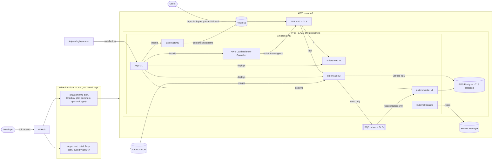

# ShipYard

**A production-style AWS platform that builds, ships, deploys, and heals a cloud application, with everything defined in code and every change reviewed.**

ShipYard is a portfolio project that shows how a real platform team runs software on AWS: infrastructure as code, GitOps deployments to Kubernetes, no static credentials anywhere, security scanning that blocks bad changes, and environments that can be switched on and off through a reviewed pull request.

> **Status:** in active development. Everything listed under [What's built](#whats-built) has been deployed and verified on AWS. Items under [Roadmap](#roadmap) are planned and not yet built.
>
> **Live demo:** [https://shipyard.paramshah.tech](https://shipyard.paramshah.tech) runs **on demand** to control cost. The full environment (EKS, RDS, ALB, DNS, TLS) spins up from a reviewed pull request in about 25 minutes and is torn down after each session. Watch the [demo video](#demo), or ask me for a live walkthrough.

---

## The three repositories

| Repository | What it holds | Highlights |
|---|---|---|
| [**shipyard-infra**](https://github.com/shahparamk/shipyard-infra) | Terraform for all AWS infrastructure | VPC, EKS, RDS, SQS, ECR, IAM; PR plan comments; approval-gated applies; enforced Checkov |
| [**shipyard-apps**](https://github.com/shahparamk/shipyard-apps) | Application code and container images | Node.js orders API + SQS worker; tests; Trivy-scanned images pushed to ECR by git SHA |
| [**shipyard-gitops**](https://github.com/shahparamk/shipyard-gitops) | What is deployed, and where | Hardened Helm chart; External Secrets; Argo CD app-of-apps |

Splitting them this way mirrors how platform teams separate concerns: **what the cloud looks like**, **what the code does**, and **what is running**. The Git history of `shipyard-gitops` is the deployment history.

---

## Architecture

**One order's journey:** a user opens https://shipyard.paramshah.tech; Route 53 points to an ALB with an ACM certificate, which routes `/api` to the API pods and everything else to the dashboard. The API stores the order in RDS over verified TLS, then queues it in SQS. A worker pod receives it, processes it idempotently, and marks it processed. Each pod has its own least-privilege IAM role through EKS Pod Identity, with no AWS keys in any pod.

---

## What's built

**Infrastructure (Terraform)**
- Remote state in a versioned, encrypted, TLS-only S3 bucket with native state locking
- Reusable modules: VPC (2 pinned AZs, flow logs, S3 endpoint), EKS, RDS, SQS
- EKS 1.37 with a managed spot node group in private subnets, access entries tied to SSO, managed add-ons, control-plane logging, and a guard against extended-support pricing
- RDS Postgres: private, reachable only from the cluster, TLS enforced, DDL and slow-query logging
- SQS with a dead-letter queue, encryption at rest, and TLS-only access
- ECR with immutable tags, scan on push, and lifecycle cleanup

**Security**
- **No static credentials anywhere:** GitHub OIDC for CI, IAM Identity Center (SSO) for operators, EKS Pod Identity for workloads
- **Database password never in Terraform state or plans:** generated with an ephemeral value and sent through write-only arguments to RDS and to a stable Secrets Manager secret, then synced into Kubernetes by External Secrets
- **Least-privilege roles per service:** the API can only send to SQS; the worker can only receive and delete
- **Scanning that blocks merges:** Checkov on Terraform (every exception documented inline with its reason), Trivy on container images
- Hardened containers: non-root, read-only filesystem, all capabilities dropped, no package managers in runtime images

**Public HTTPS entry point**
- Custom domain delegated to Route 53; DNS-validated **ACM** certificate in a persistent layer (auto-renews)
- **AWS Load Balancer Controller** builds an internet-facing ALB from a single Ingress: TLS 1.2+, HTTP→HTTPS redirect, path routing (`/api` → API, `/` → dashboard), pod-IP targets
- **ExternalDNS** publishes the hostname, scoped to one hosted zone and only touching records it owns
- Both controllers installed by Argo CD from pinned charts, each with its own least-privilege Pod Identity role

**Live dashboard**
- React dashboard served by unprivileged nginx (no Node.js at runtime, strict security headers and CSP)
- Visualizes the system live: orders flowing through the pipeline, real end-to-end latency and throughput from database timestamps, load balancing across API pods, and work distribution across worker pods

**Delivery**
- Terraform PRs: format, lint, security scan, and the plan posted as a PR comment; merges wait for manual approval in a protected environment
- App PRs: tests, Docker build, Trivy scan; merges push immutable, SHA-tagged images to ECR
- GitOps with Argo CD (app-of-apps): deploys from Git and **self-heals**, reverting manual changes within seconds
- Helm chart with readiness, liveness, and startup probes, zero-downtime rolling updates, PodDisruptionBudgets, and zone spreading

**Cost control**
- The expensive parts (EKS, NAT gateway, RDS) sit behind one `cluster_enabled` switch
- Turning the environment on or off is a reviewed one-line PR, scripted end to end, so Git always matches what is running in AWS
- Safe teardown: removes the Argo CD apps first and waits until AWS confirms the controller-created load balancer and DNS record are gone, so nothing outside Terraform is left billing

---

## Design decisions worth reading

- **Why three repos?** Infra, code, and deployment state change at different rates and for different reasons. Separating them gives each its own review flow and history.
- **Why SHA tags, never `latest`?** Every running image traces back to an exact commit, and rollback means deploying the previous SHA.
- **Why write-only secrets?** The RDS-managed password created a new secret name on every recreate, which broke GitOps. Ephemeral values plus write-only arguments give a stable secret name without ever storing the password in state.
- **Why remove npm from runtime images?** Trivy flagged HIGH CVEs that `npm ls` showed came from the base image's bundled npm, not the app. The running container never needs a package manager, so removing it fixed the CVEs and shrank the attack surface.
- **Why tear down the apps before the cluster?** The ALB and DNS record are created by controllers inside the cluster, not by Terraform. Destroying the cluster first would orphan a billing load balancer that Terraform doesn't know exists.
- **Why spin-up and teardown through PRs instead of `terraform destroy`?** A local destroy leaves Git saying the cluster should exist, so the next unrelated merge would quietly rebuild it. The PR keeps Git and AWS in sync and leaves an audit trail.

---

## Roadmap

- [x] React dashboard: live pipeline, latency/throughput, load balancing and worker distribution
- [x] Public HTTPS endpoint: AWS Load Balancer Controller, ACM certificate, Route 53 + ExternalDNS
- [ ] Observability: Prometheus, Grafana dashboards, SLO-based alerts, Loki for logs
- [ ] Autoscaling: HPA for pods, Karpenter for spot nodes, k6 load tests with recorded results
- [ ] Failure drills with written postmortems: bad deploy, OOMKill, expired secret, queue backlog, node loss
- [ ] Fix uneven worker load (batch hoarding) and measure before/after latency
- [ ] Hardening: scope down the apply role, ALB readiness gates, pin GitHub Actions to commit SHAs, CI checks for all Terraform layers, per-service database users

---

## Demo

*Demo video: add the link here (e.g. an unlisted YouTube or Loom video).*

The live site is at [https://shipyard.paramshah.tech](https://shipyard.paramshah.tech) whenever the environment is up.

---

Built by **Param Shah** · [GitHub](https://github.com/shahparamk)
