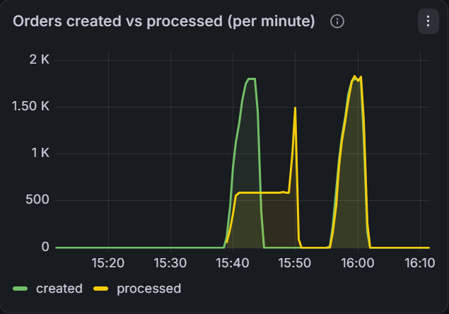
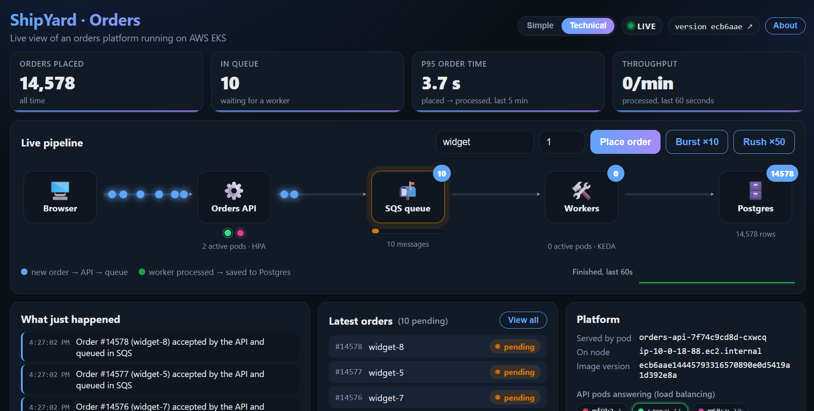
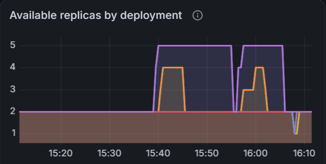
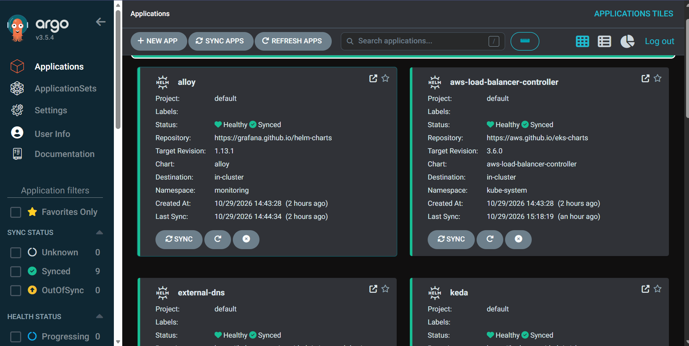
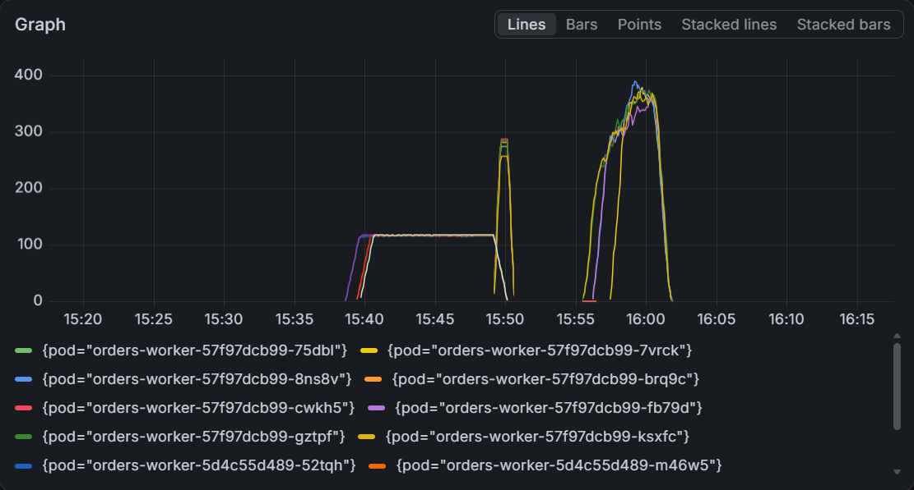
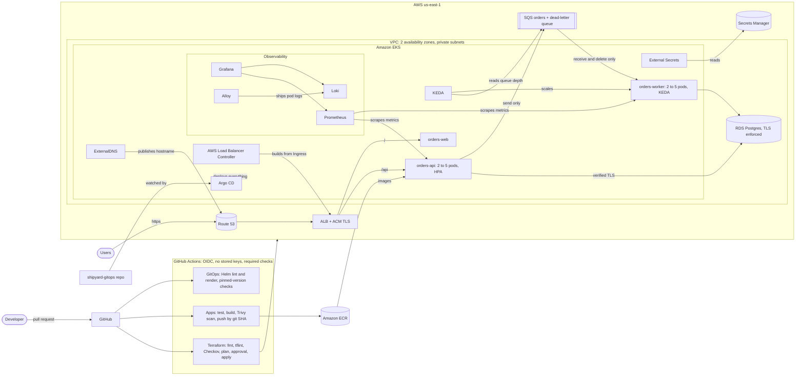

# ShipYard

**A production-style AWS platform that runs an order system the way a real company would: it absorbs traffic rushes, scales itself, survives failures, ships every change through review, and costs almost nothing when idle. Everything is defined in code.**

**Repositories:** [shipyard-infra](https://github.com/shahparamk/shipyard-infra) (Terraform) · [shipyard-apps](https://github.com/shahparamk/shipyard-apps) (code, images, load test) · [shipyard-gitops](https://github.com/shahparamk/shipyard-gitops) (deployments) · [details below](#the-three-repositories)

> **Live demo on request:** the environment runs **on demand** to keep costs near zero, so it isn't always online. The full stack (EKS, RDS, load balancer, DNS, TLS) spins up from a reviewed pull request in about 25 minutes and is torn down after each session. Until then, the [screenshots](#screenshots) and [results](#results-load-testing-found-the-real-bottleneck) show it running. [Message me on LinkedIn](https://www.linkedin.com/in/paramshah12) and I'm happy to bring it up for a live walkthrough.

---

## In plain words

Think of course registration at 8 AM: thousands of students click "Register" at the same moment. If the system fully handled each request while students waited, it would freeze.

ShipYard works like a busy restaurant:

| Restaurant | ShipYard | What it does |
|---|---|---|
| 🧾 Front desk | **Orders API** | takes the order instantly and replies in milliseconds |
| 📋 Ticket rail | **Amazon SQS queue** | holds orders safely, in line, until someone is free |
| 👩‍🍳 Kitchen staff | **Workers** | do the real work in the background and record the result |
| 📒 Order book | **PostgreSQL (RDS)** | stores every order permanently |

Customers never wait for the slow part, and **no order is lost**: a message stays in the queue until a worker confirms it's done, so a crash mid-order just means another worker picks it up. Orders that keep failing are set aside in a dead-letter queue instead of disappearing.

---

## Results: load testing found the real bottleneck

I load-tested the platform with [k6](https://k6.io) at a **sustained 30 orders per second** (7,259 orders per run), using the service's SLOs as pass/fail thresholds (p95 < 500 ms, errors < 1%). Then I changed **one thing** and ran the exact same test again.

| | **Before** | **After** |
|---|---|---|
| Worker setting | 10 messages per poll, **1 at a time** | 5 per poll, **5 in parallel** |
| Errors | 0% | 0% |
| API p95 latency | 22.6 ms | 21.4 ms |
| API pods (HPA, on CPU) | 2 → 4 | 2 → 4 |
| Worker pods (KEDA, on queue depth) | 2 → 5 (pinned at max) | 2 → 5 |
| Worker throughput | ~10 orders/s | kept up with 30 orders/s |
| Backlog after the test | **3,234 orders waiting** | **0** |
| **p95 end-to-end order time** | **226 s (≈ 4 min)** | **2.5 s** |

**What happened:** both autoscalers did their job, and the API never slowed down. But even at maximum scale, each worker processed one message at a time, so five workers could only do about 10 orders a second against 30 arriving. **Adding pods wasn't the fix; making each pod efficient was.** After the change (rolled out through a GitOps pull request), the 3,200-order backlog drained in under three minutes, and p95 end-to-end time dropped about 90×, **with no added capacity or cost**.

Both autoscalers also **scaled back down to 2** when the traffic stopped.

---

## Screenshots

| | |
|---|---|
|  **Live dashboard** during a 50-order rush: orders flow through the pipeline, pod dots appear as servers scale, and the queue gauge fills and drains |  **Autoscaling** during both tests: workers 2 → 5 (KEDA), API 2 → 4 (HPA), then back to 2 |
|  **GitOps:** every component deployed by Argo CD from Git, pinned to exact versions, all Healthy and Synced |  **Logs:** orders per worker computed purely from log lines in Loki; the two pod families show the rollout itself |

---

## The three repositories

| Repository | What it holds | Highlights |
|---|---|---|
| [**shipyard-infra**](https://github.com/shahparamk/shipyard-infra) | Terraform for all AWS infrastructure | VPC, EKS, RDS, SQS, ECR, IAM; plan posted on every PR; enforced Checkov; approval-gated applies |
| [**shipyard-apps**](https://github.com/shahparamk/shipyard-apps) | Application code, images, load test | Node.js API + SQS worker + React dashboard; 18 tests; Trivy-scanned images pushed to ECR by git SHA; k6 load test |
| [**shipyard-gitops**](https://github.com/shahparamk/shipyard-gitops) | What is deployed, and where | Hardened Helm chart; Argo CD app-of-apps; CI that validates every deploy change |

This mirrors how platform teams separate concerns: **what the cloud looks like**, **what the code does**, and **what is running**. The Git history of `shipyard-gitops` is the deployment history.

---

## Architecture

**One order's journey:** a user opens the site; Route 53 points to an ALB with an ACM certificate, which routes `/api` to the API pods and everything else to the dashboard. The API saves the order in RDS over verified TLS and puts it on the SQS queue. A worker picks it up, processes it idempotently, and marks it done. KEDA watches the queue and adds workers when it grows; the HPA adds API pods when CPU rises. Every pod has its own least-privilege IAM role through EKS Pod Identity, with no AWS keys anywhere.

---

## What's built

**Infrastructure (Terraform)**
- Remote state in a versioned, encrypted, TLS-only S3 bucket with native state locking
- Reusable modules: VPC (2 pinned AZs, flow logs, S3 endpoint), EKS, RDS, SQS
- EKS 1.37 with a managed spot node group in private subnets, SSO-based access entries, managed add-ons (including metrics-server), control-plane logging, and a guard against extended-support pricing
- RDS Postgres: private, reachable only from the cluster, TLS enforced, DDL and slow-query logging
- SQS with a dead-letter queue, encryption at rest, and TLS-only access
- ECR with immutable tags, scan on push, and lifecycle cleanup

**Reliability and scaling**
- Two availability zones, two or more replicas of everything, zone spreading, PodDisruptionBudgets, readiness/liveness/startup probes, and rolling updates configured for zero downtime
- Idempotent workers (duplicate deliveries are ignored) and a dead-letter queue for poison messages
- **HPA** scales the API on CPU; **KEDA** scales workers on **SQS queue depth** (the right signal for queue consumers, whose CPU stays low even with thousands of messages waiting)
- Worker batch size and in-pod concurrency are configurable, tuned with load-test data (see [Results](#results-load-testing-found-the-real-bottleneck))
- Argo CD **self-heals**: manual changes in the cluster are reverted to match Git within seconds

**Security**
- **No long-lived credentials:** GitHub OIDC for CI, IAM Identity Center (SSO) for operators, EKS Pod Identity for workloads
- **Database password never in Terraform state or plans:** generated with an ephemeral value, sent through write-only arguments, stored in a stable Secrets Manager secret, and synced into Kubernetes by External Secrets
- **Least-privilege roles per component:** the API can only send to SQS, the worker can only receive and delete, KEDA can only read the queue's depth, and ExternalDNS can only change one hosted zone
- **Scanning that blocks merges:** Checkov on Terraform (every exception documented inline), Trivy on every container image
- Hardened containers: non-root, read-only filesystem, all capabilities dropped, no package managers in runtime images
- Per-client **rate limiting** on the public order endpoint, keyed on the client IP the load balancer appends (so it can't be spoofed), with in-cluster traffic exempt
- **Branch protection** on all four repos: changes go through pull requests, and the required checks must pass

**Public HTTPS entry point**
- Custom domain on Route 53 with a DNS-validated ACM certificate (auto-renews)
- One Kubernetes Ingress becomes an internet-facing ALB (TLS 1.2+, HTTP→HTTPS redirect, path routing), built by the AWS Load Balancer Controller
- ExternalDNS publishes the hostname, scoped to one zone and only touching records it owns

**Observability**
- **Prometheus** scrapes the API and workers' own metrics; **Grafana** dashboards ship as code with the app's Helm chart
- **SLO-based alerts:** 99% of requests succeed, and 95% complete in under 500 ms, plus queue-backlog, worker-failure, crash-loop, and degraded-deployment alerts
- **Loki + Grafana Alloy** for centralized, searchable logs (structured JSON, low-cardinality labels; `orderId` stays in the log line)

**Live dashboard**
- React, served by unprivileged nginx with strict security headers
- A one-screen view of the system: orders flowing through the pipeline, pods appearing as autoscaling reacts, a queue gauge, a plain-English event feed, live stats from the database, and a **Simple / Technical** toggle that explains the same system to non-engineers and engineers

**Delivery**
- Terraform PRs: format, lint, security scan, and the plan posted on the PR; applies wait for manual approval in a protected environment
- App PRs: tests, Docker build, and Trivy scan; merges push immutable, SHA-tagged images
- GitOps PRs: the Helm chart is linted and rendered with the real values, a test confirms deploying without an image tag fails, every Argo app must parse, every third-party chart must be pinned to an exact version, and the image tag must be a full commit SHA (on its first run, this caught a broken file that had already been merged)
- PR checks always run, while image pushes and Terraform applies only run when relevant code changes

**Cost control**
- The expensive parts (EKS, NAT gateway, RDS) sit behind one `cluster_enabled` switch, flipped through a reviewed PR
- Safe teardown removes the Argo CD apps first and waits until AWS confirms the controller-created load balancer and DNS record are gone, so nothing outside Terraform is left billing
- Spot instances, a single NAT in dev, AWS Budgets alerts, and ECR lifecycle policies

---

## Design decisions worth reading

- **Measure before you scale.** Autoscaling worked, but it hid the real problem: each worker processed one message at a time. A load test with SLO thresholds, plus a "created vs processed" graph, showed it immediately.
- **Why KEDA for workers instead of CPU?** Queue consumers spend most of their time waiting, so their CPU stays low even when the queue is huge. Queue depth is the real measure of "are we behind?"
- **Why the autoscalers own the replica count.** When autoscaling is on, the Helm chart leaves `replicas` out. Otherwise Argo's self-heal would reset the autoscaler's changes, and the two would fight forever.
- **Why three repos?** Infra, code, and deployment state change at different rates and for different reasons; separating them gives each its own review flow and history.
- **Why SHA tags, never `latest`?** Every running image traces back to an exact commit, and rollback means deploying the previous SHA.
- **Why write-only secrets?** The RDS-managed password created a new secret name on every recreate, which broke GitOps. Ephemeral values plus write-only arguments give a stable name without storing the password in state.
- **Why webhook certificates needed care under GitOps.** Charts that generate self-signed webhook certificates at render time drift under Argo CD, which renders repeatedly. A mismatched certificate on one controller's webhook even blocked an unrelated component from being created. The fix is issuing those certificates with cert-manager instead.
- **Why tear down the apps before the cluster?** The load balancer and DNS record are created by controllers inside the cluster, not by Terraform. Destroying the cluster first would orphan a billing load balancer.

---

## In progress

- [ ] cert-manager for webhook certificates (merged; verifying on a fresh cluster)
- [ ] Small fixes from the load test: finer worker latency buckets, an "order accepted" log line for full request traces in Loki, dashboard wording
- [ ] **Karpenter:** nodes that scale with demand (today the dev cluster runs a fixed node count)
- [ ] **Failure drills with written postmortems:** bad deploy and rollback, out-of-memory kill, poison message to the dead-letter queue, wrong database secret, node loss, and the database/queue dual-write gap
- [ ] **Hardening:** narrower CI deploy role, ALB readiness gates, GitHub Actions pinned to commit SHAs, VPC CNI prefix delegation, per-service database users

---

## Demo

The platform serves a public dashboard on its own HTTPS domain **while the environment is up**. Because it runs on demand, the site is usually offline between sessions. If you'd like to see it live, [reach out on LinkedIn](https://www.linkedin.com/in/paramshah12) and I'll spin it up: it takes about 25 minutes, and you can send traffic and watch it scale in real time.

---

Built by **Param Shah** · [GitHub](https://github.com/shahparamk) · [LinkedIn](https://www.linkedin.com/in/paramshah12)
